# taskflow-gitops — dépôt GitOps du cours CI/CD M2

Ce dépôt décrit **l'état voulu** de l'application TaskFlow dans Kubernetes.
Argo CD le surveille et aligne le cluster dessus : pour changer la production,
on ne tape pas de commande, on fait une **Pull Request**.

## Installation (à faire chez vous, avant le cours)

Prérequis : Docker Desktop démarré, 8 Go de RAM, 10 Go de disque libre.
Sous Windows : WSL2 (Ubuntu) + intégration WSL de Docker Desktop, et toutes les commandes dans WSL.

```bash
git clone https://github.com/9m7fjfpv9k-cyber/taskflow-gitops.git
cd taskflow-gitops
./scripts/install.sh
```

Le script crée un cluster local `kind`, installe Argo CD et Argo Rollouts,
puis télécharge les images des labs. Comptez 5 à 15 minutes.
Il peut être relancé sans risque.

> **Note sur notre environnement.** Sur le poste de Denilsson, le trafic HTTPS sortant de WSL2 est bloqué par la politique de sécurité du poste (DNS et ICMP fonctionnent, TCP 443 expire, y compris en mode réseau mirrored). Nous avons démarré le premier lab sur le poste d'Illies pendant que l'environnement était installé directement sous Windows, avec un équivalent PowerShell de `install.sh` passant par Docker Desktop : même cluster `kind-cicd`, Argo CD v3.5.3 et Argo Rollouts v1.10.0. Les mesures des journaux ci-dessous proviennent de ce cluster.

## Structure

| Chemin | Rôle |
| --- | --- |
| `apps/taskflow/` | Les manifests surveillés par Argo CD |
| `argocd/application.yaml` | Déclare l'application dans Argo CD |
| `exemples/bluegreen/` | Manifests pour le déploiement Blue-Green |
| `exemples/canary/` | Manifests pour le déploiement Canary |
| `exemples/robustesse/` | Canary avec test de charge k6 automatique, modèle de postmortem |
| `exemples/ci/` | Pipelines de la mini-PSSI (GitHub Actions et GitLab CI) |
| `policies/` | Mini-PSSI et règles Rego vérifiées par conftest |
| `scripts/install.sh` | Installation de l'environnement |
| `scripts/argocd-ui.sh` | Ouvre l'interface d'Argo CD |
| `scripts/observe.sh` | Montre quelle version répond, et avec quel code HTTP |
| `scripts/charge.sh` | Lance à la main le test de charge k6 contre un service |

## Images disponibles

`ghcr.io/9m7fjfpv9k-cyber/taskflow` en versions `1.0.0`, `1.1.0`, `2.0.0`, `2.1.0` et `2.2.0`.

## Équipe

<!-- Noms du binôme -->
- Denilsson ([@DENFR18](https://github.com/DENFR18)) : propriétaire du fork
- Illies ([@IB432](https://github.com/IB432)) : collaborateur (write), relecteur des PR

### Notre fonctionnement en binôme

La branche `main` est protégée par un ruleset : PR obligatoire, 1 approbation, force push et suppression interdits. Aucune modification n'a donc pu atteindre `main`, et donc le cluster, sans la relecture et l'approbation de l'autre membre du binôme. La colonne « Approuvée par » des journaux indique qui a validé chaque changement.

---

## Lab du mardi matin : déployer par PR, provoquer une dérive, revenir en arrière

### Configuration

L'application Argo CD (`argocd/application.yaml`) pointe sur notre fork :

| Paramètre | Valeur | Effet |
|---|---|---|
| `repoURL` | `https://github.com/DENFR18/taskflow-gitops.git` | Argo CD suit notre fork |
| `targetRevision` | `main` | Seule la branche protégée est déployée |
| `path` | `apps/taskflow` | Dossier des manifests (Deployment de 4 replicas + Service) |
| `automated` | activé | Synchronisation automatique, sans clic |
| `selfHeal` | `true` | Toute modification manuelle du cluster est annulée |
| `prune` | `true` | Une ressource supprimée de Git est supprimée du cluster |
| `timeout.reconciliation` | `60s` | Argo CD relit Git toutes les 60 s (réglé par `install.sh`) |

### Étapes

1. **Mise en service.** Après la modification du `repoURL` (PR #2, commit `abcc67a`), `kubectl apply -f argocd/application.yaml` : l'application passe en **Synced / Healthy** avec 4 pods en 1.0.0.

   

2. **Déploiement de la 2.0.0 par PR (#3).** L'image est définie dans `apps/taskflow/deployment.yaml`. Son tag passe de `1.0.0` à `2.0.0`.

   

   Après le merge, Argo CD détecte le nouveau commit et Kubernetes effectue un rolling update : les pods 2.0.0 démarrent avant l'arrêt des pods 1.0.0, sans coupure de service.

   

3. **Dérive 1 : `kubectl scale --replicas=1`.** Argo CD détecte l'écart dans la seconde et réapplique les 4 replicas définis dans Git. Les pods `Succeeded` sont ceux arrêtés par le `scale`, les pods `Pending` ceux recréés par Argo CD.

   

4. **Dérive 2 : `kubectl set image ...:1.1.0`.** L'application passe en **OutOfSync**, puis Argo CD réapplique l'image 2.0.0.

   

   Chaque dérive suit le même cycle dans les événements de l'application : `Synced -> OutOfSync`, `Initiated automated sync`, `Partial sync operation succeeded` (seul le Deployment modifié est réappliqué), puis `Progressing -> Healthy`.

   

5. **Retour en 1.0.0 avec le bouton Revert de GitHub (PR #4).** Le revert passe par le même circuit qu'un déploiement : la PR reste bloquée tant que le binôme ne l'a pas approuvée.

   

   Après le merge (commit `19ce3cb`), les pods reviennent en 1.0.0 avec le même ReplicaSet qu'au départ (`taskflow-76547969d7`) : le modèle de pod est identique à l'original.

   

Les événements de l'application Argo CD retracent toute la séquence (heures en UTC, soit Paris − 2 h) :


### Journal des déploiements

Heures de Paris. Les heures de merge proviennent des commits de merge (`git log`), celles de synchronisation des événements Argo CD.

| Heure | Action | Commit / PR | Approuvée par | Version attendue (Git) | État Argo CD | Délai observé |
|---|---|---|---|---|---|---|
| 12:22:00 | `kubectl apply` de l'Application | PR #2 (`abcc67a`) | DENFR18 | 1.0.0 | Synced / Healthy | — |
| 13:35:17 | Merge PR image 2.0.0 | PR #3 (`5247aa8`) | IB432 | 2.0.0 | Sync auto à 13:36:09, Healthy à 13:36:21 | Détection en 52 s, déploiement complet en 1 min 04 s |
| 13:39:13 | `kubectl scale --replicas=1` (dérive) | — | — | 4 replicas | OutOfSync → sync auto immédiate → Healthy à 13:39:20 | Correction en 0 s, retour à 4 pods en 7 s |
| 13:41:10 | `kubectl set image ...:1.1.0` (dérive) | — | — | 2.0.0 | Corrigé à 13:41:10 ; nouvel OutOfSync à 13:41:24, re-sync à 13:42:04, Healthy à 13:42:11 | 0 s, puis 40 s sur le second cycle |
| 13:45:54 | Merge PR Revert (bouton GitHub) | PR #4 (`19ce3cb`) | IB432 | 1.0.0 | Sync auto à 13:46:29, Healthy à 13:46:37 | Détection en 35 s, retour complet en 43 s |

Heures de merge relevées avec `git log` :


### Réponses

**Push ou pull ?**

Pull. Aucun outil ne pousse les changements vers le cluster : c'est Argo CD, installé dans le cluster, qui relit régulièrement le dépôt Git et applique ce qui a changé. Nos mesures le montrent : après un merge, le déploiement n'est pas immédiat, il arrive au prochain cycle de lecture (52 s pour la 2.0.0, 35 s pour le revert, toujours sous les 60 s de `timeout.reconciliation`). Conséquence côté sécurité : GitHub n'a besoin d'aucun accès au cluster, c'est le cluster qui vient chercher l'état voulu.

**Qui a corrigé quoi ?**

Les modifications manuelles faites avec `kubectl` ont été corrigées par **Argo CD**, grâce à `selfHeal` : le passage à 1 replica et le changement d'image vers 1.1.0 ont été annulés dans la seconde, par une synchronisation partielle qui réapplique uniquement le Deployment modifié. Sur la dérive d'image, une seconde détection n'a été corrigée qu'après 40 s ; nous l'interprétons comme un délai croissant appliqué par Argo CD entre deux self-heals successifs, sans l'avoir vérifié dans la documentation. Le retour de la 2.0.0 vers la 1.0.0, lui, a été décidé et fait par **nous**, via une PR de revert relue et approuvée : Argo CD n'a fait qu'appliquer ce que Git contenait.

**Pourquoi git revert ?**

`git revert` ajoute un nouveau commit qui annule le précédent, sans réécrire l'historique. Le retour arrière passe donc par le même circuit qu'un déploiement : PR, approbation du binôme, ruleset (le force push étant interdit sur `main`, un `git reset` ne serait de toute façon pas possible). L'historique garde la trace de qui a annulé quoi et quand, et Git reste la seule source de vérité. À l'inverse, un `kubectl rollout undo` serait une dérive comme les autres, qu'Argo CD annulerait immédiatement grâce au self-heal.

---

## Lab du mardi après-midi : 1.0.0 → Blue-Green → 1.1.0 → Canary → 2.0.0

Le Deployment est remplacé par une ressource `Rollout` d'Argo Rollouts. Toutes les modifications passent par PR ; seules les commandes `promote` et `abort` sont faites à la main, car elles pilotent le déploiement en cours sans changer l'état voulu.

Point de départ, mesuré avec `observe.sh` (40 requêtes depuis le cluster) :

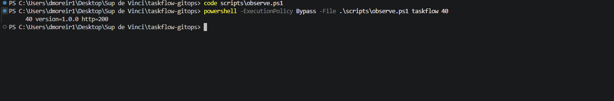

### A. Blue-Green

1. **Passage au Rollout Blue-Green (PR #6).** Argo CD crée le Rollout et `taskflow-preview`, et supprime le Deployment (`prune`). Le service `taskflow` n'est pas recréé : aucune coupure.

   

2. **Image 1.1.0 (PR #7).** La 1.1.0 démarre à côté de la 1.0.0 et le Rollout se met en pause : **8 pods** tournent en même temps.

   

3. **Comparaison des deux services.** `taskflow` répond 100 % en 1.0.0, `taskflow-preview` 100 % en 1.1.0.

   

4. **Promote.** Bascule instantanée de `taskflow` vers la 1.1.0, puis suppression des pods 1.0.0 au bout de 30 s (`scaleDownDelaySeconds`).

   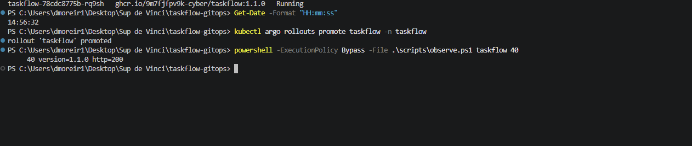

   

### B. Canary

1. **Passage en Canary, toujours en 1.1.0 (PR #8).** Seule la stratégie change : aucun pod recréé, `taskflow-preview` supprimé.

   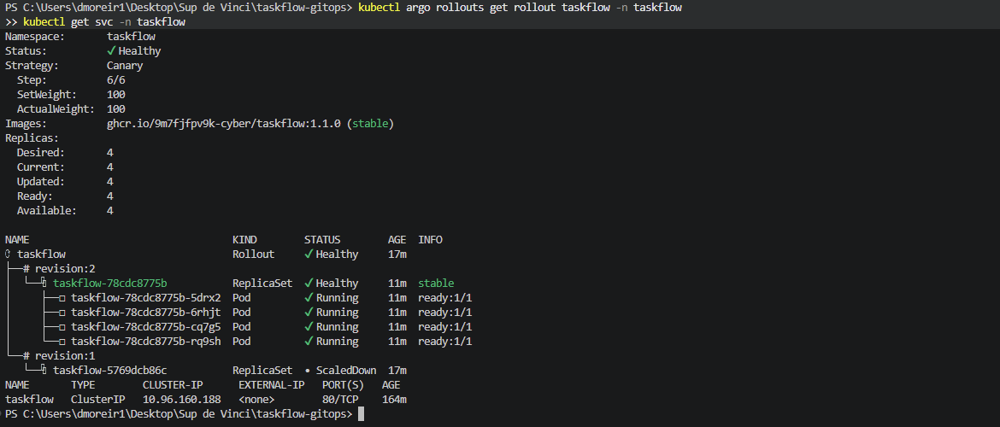

2. **Image 2.0.0 (PR #9).** Palier de 25 % : 1 pod en 2.0.0 et 3 en 1.1.0, soit **4 pods au total**.

   

   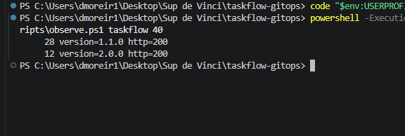

3. **Promote jusqu'à 100 %.** Un premier `promote` passe à 50 %, un second saute la pause de 60 s et passe à 75 %, puis le Rollout atteint 100 % seul.

   

   L'âge des pods 2.0.0 retrace l'escalier des paliers :

   

4. **Image 2.1.0, puis abort.** Au palier de 25 %, Argo CD affiche l'application en **Suspended**, et la 2.1.0 renvoie des HTTP 500.

   

   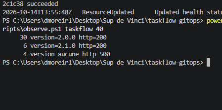

   Après l'`abort`, le trafic revient entièrement en 2.0.0 :

   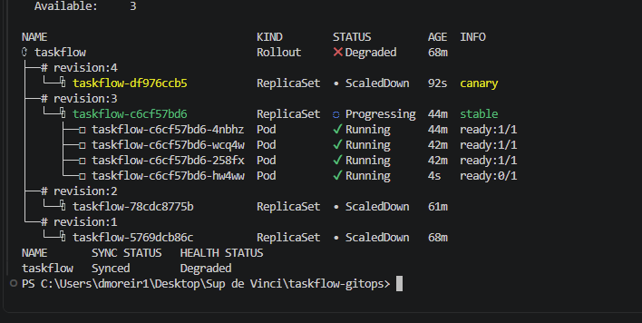

   

   

   Mais Argo CD reste **Synced + Degraded** (`Updated: 0`) tant que Git demande la 2.1.0 :

   

   Le revert de la PR 2.1.0 ramène l'ensemble en Healthy :

   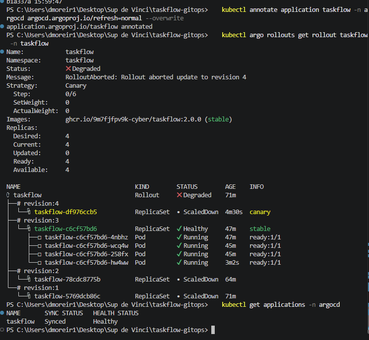

### Journal des déploiements

Heures de Paris. Les heures de merge proviennent de `git log`, les autres des événements Argo CD et Argo Rollouts. La répartition du trafic est mesurée avec `observe.sh` (40 requêtes depuis le cluster).

#### A. Blue-Green

| Heure | Action | Commit / PR | Approuvée par | Version | État | Observation |
|---|---|---|---|---|---|---|
| 14:48:08 | Merge PR : Deployment → Rollout Blue-Green | PR #6 (`234541b`) | IB432 | 1.0.0 | Sync à 14:49:02, Healthy à 14:49:09 | Deployment supprimé (prune), service `taskflow` conservé, `taskflow-preview` créé. Aucune coupure |
| 14:55:09 | Merge PR image 1.1.0 | PR #7 (`5e870f3`) | IB432 | 1.1.0 | Rollout **Paused** (BlueGreenPause) | **8 pods** (4 × 1.0.0 + 4 × 1.1.0). `taskflow` : 40 × 1.0.0 ; `taskflow-preview` : 40 × 1.1.0 |
| 14:56:32 | `promote` | — | — | 1.1.0 | Healthy, 1.1.0 stable/active | `taskflow` : 40 × 1.1.0, HTTP 200. Bascule instantanée, pods 1.0.0 supprimés 30 s après |

#### B. Canary

| Heure | Action | Commit / PR | Approuvée par | Version | État | Observation |
|---|---|---|---|---|---|---|
| 15:03:30 | Merge PR : passage en Canary | PR #8 (`4fe3e89`) | IB432 | 1.1.0 | Healthy, step 6/6 | Aucun pod recréé, `taskflow-preview` supprimé (prune) |
| 15:12:40 | Merge PR image 2.0.0 | PR #9 (`a3708f2`) | IB432 | 2.0.0 | Paused (CanaryPauseStep), step 1/6, 25 % | **4 pods** (1 × 2.0.0 + 3 × 1.1.0). Trafic : 12/40 en 2.0.0 (30 %) |
| 15:13:46 | `promote` | — | — | 2.0.0 | Palier 50 % | — |
| 15:14:11 | 2ᵉ `promote` | — | — | 2.0.0 | Palier 75 % (pause de 60 s du palier 50 % sautée) | Trafic : 32/40 en 2.0.0 (80 %) |
| ≈ 15:14:45 | Fin automatique de la pause de 30 s | — | — | 2.0.0 | Healthy, step 6/6 | Trafic : 40 × 2.0.0, HTTP 200 |
| 15:55:14 | Merge PR image 2.1.0 | `922cb3b` | IB432 | 2.1.0 | Sync à 15:55:41, Paused à 15:55:48 (Argo CD : **Suspended**) | 1 × 2.1.0 + 3 × 2.0.0. Trafic : 30 × 2.0.0 (200), 6 × 2.1.0 (200), **4 × HTTP 500** |
| 15:57:09 | `abort` | — | — | 2.0.0 servie, 2.1.0 dans Git | **Synced + Degraded** | Canary supprimé, retour à 4 pods 2.0.0. Trafic : 40 × 2.0.0, HTTP 200 |
| 15:59:47 | Merge PR Revert de la 2.1.0 | `b1a337a` | IB432 | 2.0.0 | **Synced + Healthy** | Git et cluster de nouveau cohérents, aucun pod recréé |

### Ce qu'a montré la 2.1.0

- La 2.1.0 passe sa sonde `/health` : Kubernetes la considère comme saine. Seul le trafic réel révèle le défaut : 4 réponses en HTTP 500 sur les 10 qu'elle a servies (40 % d'échec).
- Grâce au palier de 25 %, seules **4 requêtes sur 40 (10 %)** ont échoué côté utilisateurs, pendant environ **1 min 20 s** (de 15:55:48 à 15:57:09).
- **Et après l'abort ?** Le trafic est protégé, mais rien n'est réglé : Git demande toujours la 2.1.0. Argo CD affiche **Synced** (le Rollout correspond à Git, le self-heal n'a rien à corriger) et **Degraded** (l'état voulu n'est pas atteint). Le Rollout reste bloqué avec `Updated: 0` tant qu'on ne corrige pas Git. L'`abort` est un frein d'urgence ; la correction, c'est le **revert par PR**.

### Blue-Green ou Canary pour TaskFlow ?

**Canary**, pour les mises à jour courantes de TaskFlow.

**Sur le risque.** Le Blue-Green bascule 100 % du trafic d'un coup au `promote`. Si la 2.1.0 avait été déployée ainsi, environ 40 % de toutes les requêtes auraient échoué, jusqu'au retour arrière. Le service de preview ne protège que si quelqu'un le teste vraiment avant de promouvoir : sans trafic réel, un défaut comme celui de la 2.1.0, qui passe les sondes de santé, peut passer inaperçu. Le Canary expose la nouvelle version à une petite part du vrai trafic : 25 % ici, soit 10 % d'erreurs côté utilisateurs au lieu de 40 %. Le défaut a été repéré au premier palier et coupé par un `abort`.

**Sur le coût.** Pendant la phase de vérification, le Blue-Green a fait tourner **8 pods** (deux versions complètes en parallèle), soit le double des ressources. Le Canary est resté à **4 pods** à chaque palier : il remplace progressivement les pods stables au lieu de les dupliquer.

**Ce que le Blue-Green apporte quand même.** Une bascule et un retour arrière instantanés et totaux : aucune requête n'est servie par un mélange de versions. C'est préférable pour un changement incompatible entre versions (format d'API, schéma de base de données), où deux versions ne doivent pas répondre en même temps. Pour TaskFlow, dont les versions coexistent sans problème, cet avantage ne compense pas le double coût et l'exposition totale en cas de défaut.

**Limite de notre Canary.** Sans maillage de service, la part de trafic suit la proportion de pods (25 % = 1 pod sur 4) et la répartition mesurée varie (30 % au lieu de 25 %, 80 % au lieu de 75 %). Les paliers ne peuvent pas descendre sous 1 pod, soit 25 % avec 4 replicas. Pour un canary plus fin, il faudrait plus de replicas ou un routage par un ingress ou un service mesh.

---

## Lab du jeudi matin : 2.0.0 → 2.1.0 → abort automatique → 2.2.0

Le Canary intègre désormais une **analyse automatique** : au palier de 25 %, Argo Rollouts lance un test de charge k6 contre le service `taskflow-canary`, qui ne vise que la nouvelle version. Seuils exigés : moins de 2 % d'erreurs et p95 sous 250 ms. Si le test échoue, le déploiement est annulé sans intervention humaine.

### A. L'étalon et l'analyse

Nous avons d'abord mesuré la production en 2.0.0 avec `charge.sh`, pour disposer d'une référence :

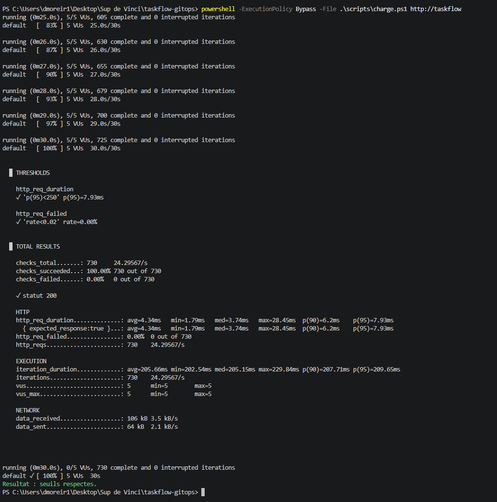

Puis la PR `feat/analyse-auto` a ajouté dans `apps/taskflow/` le Rollout avec analyse, l'AnalysisTemplate `robustesse-k6`, la ConfigMap `k6-robustesse` et le service `taskflow-canary`. Résultat : un Rollout, aucun Deployment, et aucun pod recréé.

### B. L'incident 2.1.0

Nous avons déployé la 2.1.0 sans intervenir. L'analyse k6 a échoué et le Rollout a été annulé automatiquement :

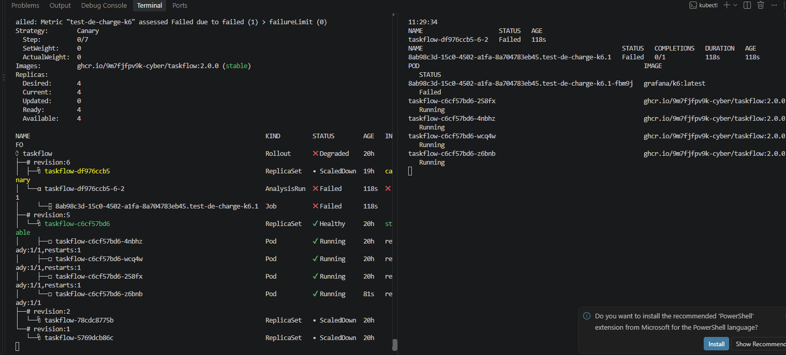

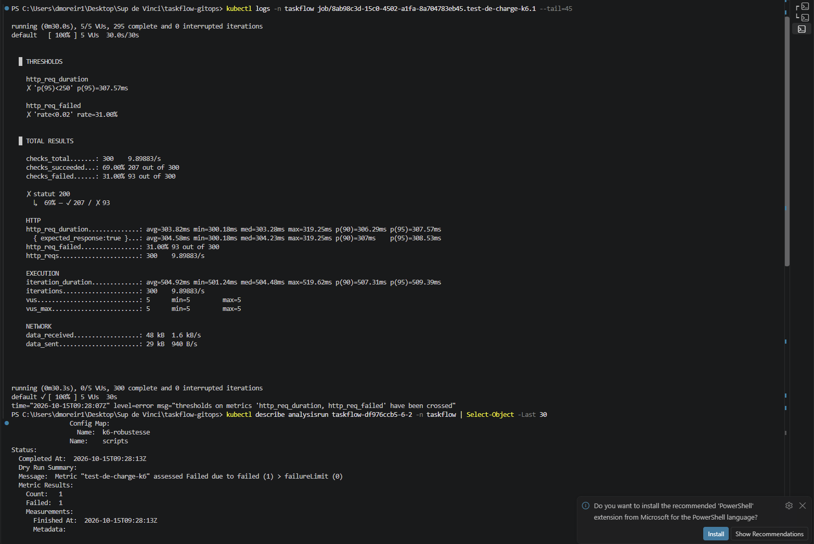

Après le revert de la 2.1.0, nous avons déployé la 2.2.0. L'analyse a réussi et le Rollout est monté seul jusqu'à 100 % :

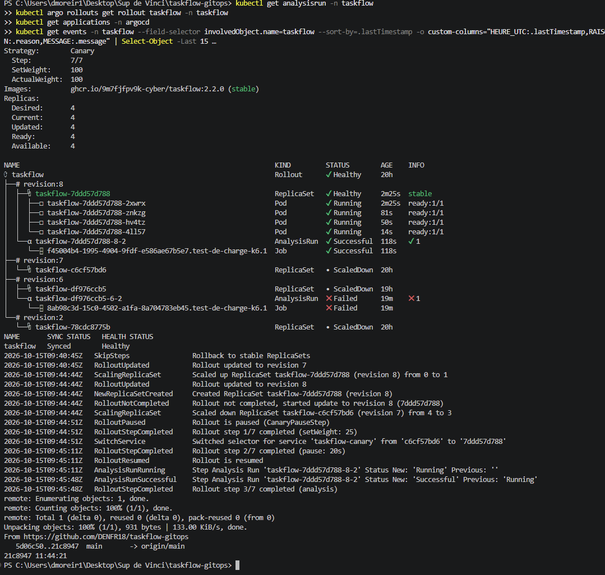

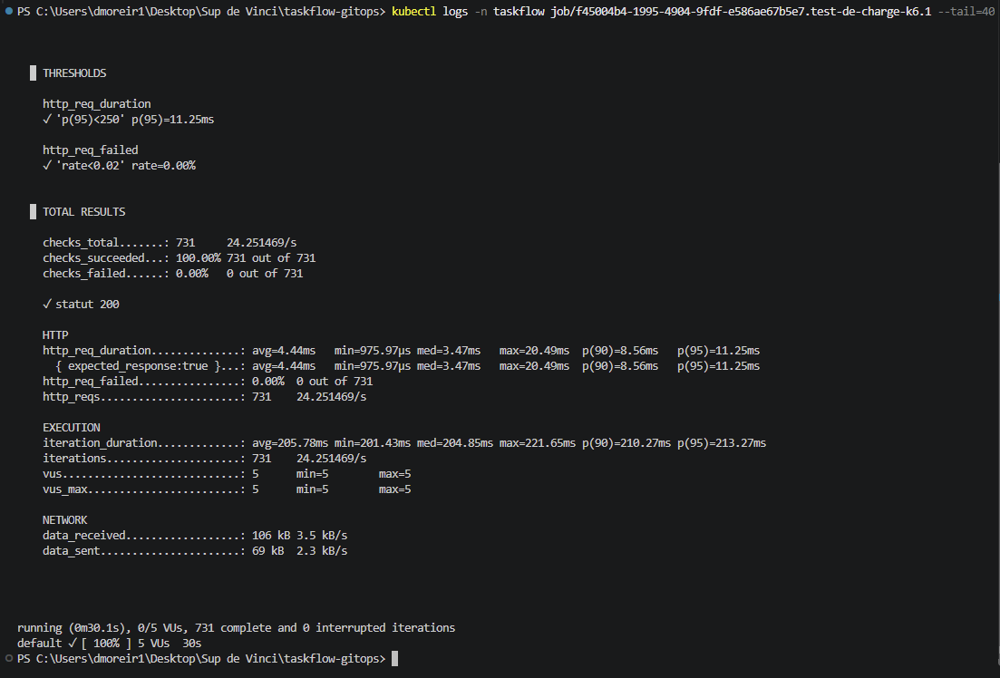

Analyse complète de l'incident : [`docs/postmortem-2.1.0.md`](docs/postmortem-2.1.0.md)

### Journal des déploiements

Heures de Paris. Sources : `git log`, événements Argo CD et Argo Rollouts, logs des Jobs k6.

| Heure | Action | Commit | Approuvée par | Version | État | Observation |
|---|---|---|---|---|---|---|
| ≈ 11:12 | Étalon : `charge.sh` sur `http://taskflow` | — | — | 2.0.0 | Healthy | 730 requêtes, 0,00 % d'erreurs, p95 = 7,93 ms |
| 11:16:26 | Merge PR `feat/analyse-auto` | `64e15fd` | IB432 | 2.0.0 | Healthy, step 7/7 | AnalysisTemplate, ConfigMap k6 et `taskflow-canary` créés. Un Rollout, aucun Deployment |
| 11:27:08 | Merge PR image 2.1.0 | `67af830` | IB432 | 2.1.0 | Canary 25 % à 11:27:16, AnalysisRun à 11:27:36 | — |
| 11:28:13 | **Abort automatique** | — | — | 2.0.0 servie | AnalysisRun Failed, Rollout Degraded, Argo CD Synced + Degraded | k6 : 31 % d'erreurs, p95 = 307,57 ms |
| 11:40:14 | Merge revert de la 2.1.0 | `5d06c50` | IB432 | 2.0.0 | Healthy à 11:40:45 (revision 7) | Aucun pod recréé |
| 11:44:21 | Merge PR image 2.2.0 | `21c8947` | IB432 | 2.2.0 | Canary 25 % à 11:44:51, AnalysisRun à 11:45:11 | — |
| 11:45:48 | **AnalysisRun Successful** | — | — | 2.2.0 | Step 3/7, montée à 50 % | k6 : 0,00 % d'erreurs, p95 = 11,25 ms |
| ≈ 11:47 | Fin de la montée | — | — | 2.2.0 | Healthy, step 7/7, Synced + Healthy | 4 pods en 2.2.0 |