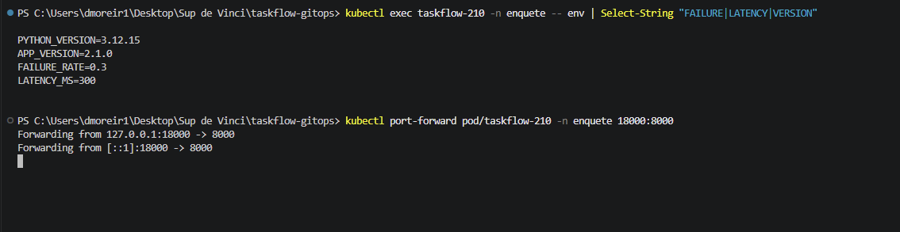
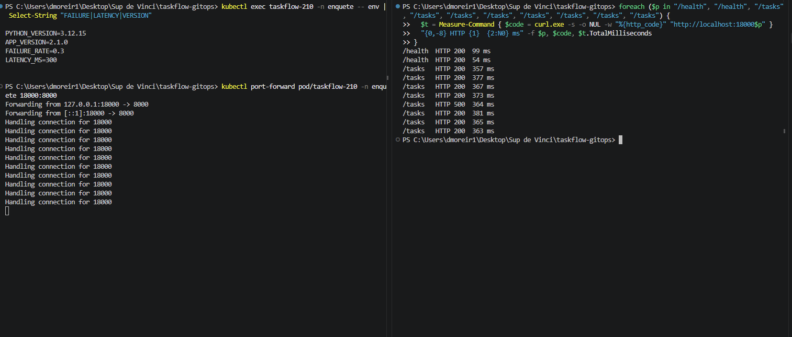

# Postmortem — TaskFlow 2.1.0 : erreurs et latence injectées dans l'image


| Champ | Valeur |
| --- | --- |
| Date et heure | 15 octobre 2026, de 11:27:08 (merge) à 11:28:13 (abort automatique), heure de Paris |
| Version en cause | `ghcr.io/9m7fjfpv9k-cyber/taskflow:2.1.0` |
| PR à l'origine | PR image 2.1.0 (merge `67af830`), approuvée par IB432 |
| Durée d'exposition | ≈ 57 s, de 11:27:16 (bascule du canary à 25 %) à 11:28:13 (abort) |
| Part du trafic touché | ≈ 25 % du trafic de production (1 pod sur 4). Sur cette part, 31 % de requêtes en erreur et +300 ms de latence, soit ≈ 8 % des requêtes utilisateurs en erreur (estimation déduite de la proportion de pods, non mesurée en production) |
| Détecté par | Test de charge k6 lancé automatiquement par Argo Rollouts (AnalysisRun `taskflow-df976ccb5-6-2`) |
| Résolu par | Abort automatique du canary (trafic) à 11:28:13, puis `git revert` de la PR 2.1.0 (état voulu) à 11:40:14 |

## Chronologie

Heures de Paris. Sources : `git log`, événements Argo Rollouts et Argo CD, logs du Job k6.

| Heure | Événement |
| --- | --- |
| 11:12 | Étalon sur la production 2.0.0 (`charge.sh`) : 0,00 % d'erreurs, p95 = 7,93 ms |
| 11:16:26 | Merge de la PR `feat/analyse-auto` (`64e15fd`) : Rollout canary avec analyse k6 au palier de 25 % |
| 11:27:08 | Merge de la PR image 2.1.0 (`67af830`) |
| 11:27:10 | Argo Rollouts crée le pod canary 2.1.0 (revision 6) |
| 11:27:16 | Palier de 25 % : `taskflow-canary` bascule vers la 2.1.0, pause de 20 s |
| 11:27:36 | Fin de la pause, lancement de l'AnalysisRun et du Job k6 sur `taskflow-canary` |
| 11:28:07 | k6 : seuils `http_req_failed` et `http_req_duration` franchis |
| 11:28:13 | AnalysisRun **Failed**, Rollout **aborted** : `taskflow-canary` revient sur la 2.0.0, stable remontée à 4 pods, canary à 0 |
| 11:28 → 11:40 | Production saine en 2.0.0. Argo CD : **Synced + Degraded** (Git demande toujours la 2.1.0) |
| 11:28 → 11:34 | Notre enquête sur un pod 2.1.0 isolé (namespace `enquete`, hors production) |
| 11:40:14 | Merge du revert de la PR 2.1.0 (`5d06c50`), approuvé par IB432 |
| 11:40:45 | Argo Rollouts : retour au ReplicaSet stable (revision 7), Rollout **Healthy**, aucun pod recréé |

## Composant défaillant et cause racine

**Quel composant a échoué ?** L'image applicative 2.1.0 elle-même : elle a été construite avec l'injection de pannes activée.

```
$ kubectl exec taskflow-210 -n enquete -- env | Select-String "FAILURE|LATENCY|VERSION"
APP_VERSION=2.1.0
FAILURE_RATE=0.3
LATENCY_MS=300
```



Nos mesures concordent avec cette configuration :

| Mesure (k6, 30 s, 5 VU) | 2.0.0 (étalon) | 2.1.0 | 2.2.0 | Seuil |
| --- | --- | --- | --- | --- |
| Taux d'erreur | 0,00 % | **31,00 %** (93 / 300) | 0,00 % | < 2 % |
| p95 | 7,93 ms | **307,57 ms** | 11,25 ms | < 250 ms |
| Latence minimum | 1,79 ms | **300,18 ms** | 0,98 ms | — |
| Débit | 24,3 req/s | 9,9 req/s | 24,3 req/s | — |

La latence minimum de 300 ms montre un délai fixe ajouté à chaque requête, et non une surcharge.

**Pourquoi les probes Kubernetes ne l'ont-elles pas vu ?** Les sondes `readinessProbe` et `livenessProbe` interrogent uniquement `/health`, qui est volontairement épargné par l'injection de pannes. Sur le pod isolé, `/health` répond 200 en 54 à 99 ms, tandis que `/tasks` répond en 357 à 381 ms avec des HTTP 500. Kubernetes considérait donc le pod comme sain et lui envoyait du trafic.



**Cause racine :** les paramètres d'injection de pannes (`FAILURE_RATE`, `LATENCY_MS`) sont figés dans l'image au moment du build, sans contrôle automatique avant publication. Une image destinée aux exercices de fiabilité a pu être déployée comme une version normale : rien dans la chaîne (build, PR, sondes) ne distinguait une image piégée d'une image saine. La relecture de la PR ne pouvait pas non plus le voir : le diff ne montrait qu'un changement de tag, la configuration étant cachée dans l'image.

## Ce qui a bien fonctionné

- **L'analyse automatique a joué son rôle** : détection et abort en 37 s après le début du test, 65 s après le merge, sans aucune intervention humaine.
- **Le canary a limité l'impact** : seuls ≈ 25 % du trafic ont atteint la 2.1.0, pendant moins d'une minute. Un Blue-Green promu aurait exposé 100 % du trafic.
- **Le test vise le bon service** : k6 interroge `taskflow-canary`, qui ne cible que la nouvelle version ; le résultat n'est pas dilué par les pods stables.
- **Le retour à la normale passe par Git** : le revert a été relu et approuvé comme tout changement, et Argo CD est revenu en Synced + Healthy sans recréer de pods.
- **Notre enquête n'a pas touché la production** : la 2.1.0 a été analysée dans un namespace isolé, supprimé ensuite.

## Actions correctives

| Action | Responsable | Échéance |
| --- | --- | --- |
| Ne plus figer `FAILURE_RATE` et `LATENCY_MS` dans l'image : les injecter à l'exécution (ConfigMap ou variables du Rollout), avec 0 par défaut | À répartir | À fixer |
| Ajouter une étape de CI qui inspecte l'image avant publication et échoue si `FAILURE_RATE` ≠ 0 ou `LATENCY_MS` ≠ 0 | À répartir | À fixer |
| Ajouter une sonde de disponibilité représentative du trafic réel (par exemple un `/ready` qui interroge `/tasks`), en plus de `/health` | À répartir | À fixer |
| Ajouter une seconde analyse k6 au palier de 50 %, pour détecter les défauts qui n'apparaissent qu'avec plus de charge | À répartir | À fixer |
| Marquer le tag 2.1.0 comme interdit au déploiement (règle conftest dans `policies/`) | À répartir | À fixer |